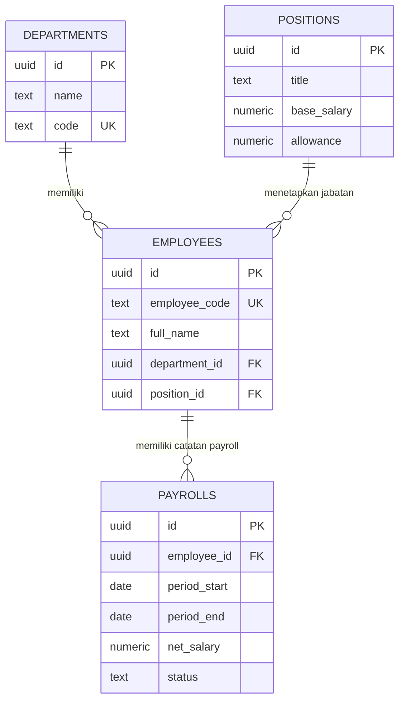

<div align="center">


# ArthaCore
### Enterprise Payroll System

**Sistem pengelolaan data karyawan dan penggajian perusahaan berbasis web**

<p>
  <a href="https://faniahm7.github.io/SistemPenggajianKaryawan/">
    
  </a>
</p>


<p>
  
  
</p>

</div>

<table align="center">
  <tr>
    <td align="center"><strong>PEOPLE</strong><br><sub>Data karyawan</sub></td>
    <td align="center"><strong>STRUCTURE</strong><br><sub>Departemen & jabatan</sub></td>
    <td align="center"><strong>PAYROLL</strong><br><sub>Administrasi penggajian</sub></td>
  </tr>
</table>

---

## Navigasi README

<p align="center">
  <a href="#01--gambaran-proyek">Gambaran Proyek</a> ·
  <a href="#02--fitur-sistem">Fitur</a> ·
  <a href="#06--struktur-repository">Repository</a> ·
  <a href="#07--dokumentasi-database">Database & ERD</a> ·
  <a href="#09--cara-mengakses">Akses Sistem</a>
</p>

---

## Identitas Penyusun

<div align="center">

| Keterangan | Identitas |
|:--|:--|
| **Nama** | Fania Hidayatul Mustafidah |
| **NIM** | 12030124130178 |
| **Mata Kuliah / Kelas** | Pengkodean dan Pemrograman / D |
| **Dosen Pengampu** | Dr. Totok Dewayanto, S.E., M.Si., Akt., CA |
| **Program Studi** | S1 Akuntansi |
| **Fakultas** | Ekonomika dan Bisnis |
| **Universitas** | Universitas Diponegoro |

</div>

---

<div align="center">


</div>

## 01 — Gambaran Proyek

**ArthaCore** merupakan sistem penggajian karyawan berbasis web yang dirancang untuk membantu pengelolaan informasi sumber daya manusia dan administrasi payroll dalam satu ruang kerja. Sistem ini memiliki tampilan bergaya *enterprise* dengan fokus pada kemudahan navigasi, penyajian ringkasan, dan pengelolaan data yang terstruktur.

Melalui ArthaCore, pengguna dapat mengakses dashboard, mengelola data karyawan, menyusun struktur departemen dan jabatan, serta mencatat proses penggajian berdasarkan periode. Proyek ini dikembangkan sebagai bagian dari mata kuliah **Pengkodean dan Pemrograman** pada Program Studi S1 Akuntansi, Fakultas Ekonomika dan Bisnis, Universitas Diponegoro.

<div align="center">


</div>

## 02 — Fitur Sistem

<table>
<tr>
<td width="50%" valign="top">

### Dashboard
Menampilkan ringkasan informasi perusahaan, antara lain:
- Total karyawan
- Jumlah departemen
- Posisi jabatan
- Payroll bulan berjalan
- Tren gaji bersih enam bulan terakhir
- Komposisi karyawan berdasarkan departemen
- Aktivitas penggajian terbaru

### Data Karyawan
Mendukung pengelolaan informasi karyawan, termasuk:
- Nama dan kode karyawan
- Informasi perusahaan
- Departemen dan jabatan
- Tanggal bergabung
- Status karyawan
- Gaji pokok

</td>
<td width="50%" valign="top">

### Data Departemen
Digunakan untuk mengelola unit dan struktur organisasi perusahaan, termasuk pencarian data departemen.

### Data Jabatan
Membantu pengelolaan posisi dalam perusahaan dengan informasi seperti:
- Nama jabatan
- Grade
- Gaji pokok
- Tunjangan
- Jumlah karyawan pada jabatan terkait

### Data Penggajian
Digunakan untuk mencatat dan meninjau informasi payroll, meliputi:
- Karyawan dan periode penggajian
- Gaji pokok
- Tunjangan
- Potongan
- Gaji bersih
- Status pembayaran

</td>
</tr>
</table>

### Akses cepat

Dashboard juga menyediakan akses langsung untuk menambahkan karyawan, mengatur departemen, dan membuat catatan penggajian agar aktivitas utama dapat dijangkau dengan lebih praktis.

---

<div align="center">


</div>

## 03 — Alur Penggunaan


Alur di atas menggambarkan proses penggunaan secara umum: data karyawan dan struktur organisasi dikelola terlebih dahulu, kemudian digunakan sebagai dasar pencatatan penggajian.

---

<div align="center">


</div>

## 04 — Identitas Visual

ArthaCore menggunakan pendekatan visual **cokelat tua** untuk membangun kesan profesional, stabil, dan elegan. Warna netral dan aksen cokelat membantu menjaga tampilan tetap konsisten untuk kebutuhan administrasi HR dan Finance.

| Warna | Kode warna | Peran visual |
|:--|:--|:--|
|  **Espresso** | `#2B1B14` | Warna gelap utama dan kontras |
|  **Dark Brown** | `#3B271C` | Elemen pendukung dan penekanan |
|  **Walnut** | `#5A3825` | Warna aksen utama |
|  **Warm Brown** | `#6F4E37` | Aksen sekunder dan label |
|  **Cream** | `#F5F0E8` | Warna netral pendamping |

*Kode warna di atas merupakan palet dokumentasi yang diselaraskan dengan tema cokelat tua, bukan hasil pengukuran langsung seluruh warna CSS website.*

---

## 05 — Teknologi dan Platform

<div align="center">


</div>

| Komponen | Teknologi / platform | Kegunaan |
|:--|:--|:--|
| Antarmuka | HTML, CSS, JavaScript | Menyajikan halaman dan interaksi sistem |
| Database | Supabase (PostgreSQL) | Menyimpan data departemen, jabatan, karyawan, dan penggajian |
| Skema database | `schema.sql` | Skrip SQL untuk membuat dan memperbarui struktur tabel |
| Hosting | GitHub Pages | Menayangkan aplikasi melalui web |
| Dokumentasi | Markdown (`README.md`) | Menjelaskan sistem dan cara mengaksesnya |

> **Catatan:** rincian implementasi dan konfigurasi database dapat disesuaikan dengan versi kode yang digunakan pada repository.

---

<div align="center">


</div>

## 06 — Struktur Repository

Repository ArthaCore disusun dengan memisahkan file antarmuka, logika aplikasi, konfigurasi koneksi, aset visual, dan skema database agar setiap bagian lebih mudah ditemukan dan dipelihara.

```text
SistemPenggajianKaryawan/
├── assets/       # Aset visual yang digunakan oleh antarmuka
├── index.html    # Struktur halaman utama aplikasi
├── styles.css    # Gaya visual dan tata letak antarmuka
├── app.js        # Logika interaksi dan fungsi aplikasi
├── config.js     # Konfigurasi aplikasi dan koneksi layanan
├── schema.sql    # Skema dan aturan database Supabase
└── README.md    # Dokumentasi proyek
```

**Fungsi file utama:**

| File / Folder | Keterangan |
|:--|:--|
| `assets/` | Menyimpan aset pendukung antarmuka, seperti gambar atau ilustrasi. |
| `index.html` | Menjadi titik masuk halaman web ArthaCore. |
| `styles.css` | Mengatur warna, tipografi, komponen, dan tata letak halaman. |
| `app.js` | Menangani perilaku antarmuka dan proses pengelolaan data. |
| `config.js` | Menyimpan konfigurasi yang digunakan aplikasi saat mengakses layanan. Pastikan tidak menaruh kunci rahasia di file frontend. |
| `schema.sql` | Berisi perintah SQL untuk membuat atau memperbarui struktur database. |
| `README.md` | Menyediakan informasi proyek, fitur, struktur repository, dan dokumentasi database. |

---

<div align="center">


</div>

## 07 — Dokumentasi Database

ArthaCore menggunakan **Supabase berbasis PostgreSQL**. Skema database pada repository mendefinisikan empat entitas utama yang saling terhubung untuk mendukung data organisasi, data karyawan, dan pencatatan penggajian.

<div align="center">

<a href="https://bit.ly/LaporanSkemaERDArthaCore">
  
</a>

<p><strong>Dokumentasi ERD ArthaCore</strong><br />
Klik tombol di atas untuk membuka laporan skema database lengkap.</p>

</div>

### Entitas utama

| Tabel | Fungsi | Informasi penting |
|:--|:--|:--|
| `departments` | Menyimpan data departemen atau unit organisasi. | ID, nama, kode departemen, manajer, lokasi, dan deskripsi. |
| `positions` | Menyimpan data jabatan dan komponen kompensasi dasar. | Nama jabatan, grade, gaji pokok, dan tunjangan. |
| `employees` | Menyimpan identitas dan status kepegawaian. | Kode dan nama karyawan, perusahaan, departemen, jabatan, tanggal bergabung, status, dan gaji pokok. |
| `payrolls` | Menyimpan rincian penggajian setiap karyawan untuk periode tertentu. | Periode, gaji pokok, tunjangan, lembur, bonus, potongan, PPh 21, komponen BPJS, gaji bersih, dan status pembayaran. |

### Relasi antartabel



### Aturan dan integritas data

- Setiap tabel menggunakan ID bertipe UUID sebagai identitas utama.
- Kode karyawan dan kode departemen dibuat unik agar tidak terjadi duplikasi kode.
- Data karyawan terhubung ke departemen dan jabatan melalui foreign key.
- Catatan penggajian terhubung ke satu karyawan dan memiliki batas periode penggajian.
- Sistem database menghitung `net_salary` dari komponen pendapatan dan potongan yang tercatat, termasuk gaji pokok, tunjangan, lembur, bonus, potongan, PPh 21, dan komponen BPJS karyawan tertentu.
- Skrip `schema.sql` juga mendefinisikan indeks, mekanisme pembaruan kolom `updated_at`, serta kebijakan akses tabel.

### Cara melihat atau menyiapkan skema

1. Buka [dokumentasi ERD ArthaCore](https://bit.ly/LaporanSkemaERDArthaCore) untuk melihat diagram dan penjelasan skema.
2. Buka file [`schema.sql`](https://github.com/faniahm7/SistemPenggajianKaryawan/blob/main/schema.sql) pada repository untuk melihat definisi tabel dan aturan SQL.
3. Jika ingin menerapkan skema, buka **SQL Editor** pada project Supabase yang sesuai, lalu tinjau isi `schema.sql` terlebih dahulu sebelum menjalankannya.
4. Gunakan project database terpisah untuk demonstrasi atau pengujian. Tinjau kebijakan akses sebelum menyimpan data karyawan atau penggajian yang sebenarnya.

> **Catatan keamanan:** skema saat ini memuat kebijakan demo yang memberi akses luas pada peran `anon` dan `authenticated`. Jangan gunakan konfigurasi tersebut untuk data payroll riil sebelum kebijakan Row Level Security (RLS) diperketat dan diuji.

---

<div align="center">


</div>

## 08 — Struktur Menu

| Menu | Fungsi |
|:--|:--|
| **Dashboard** | Melihat ringkasan data dan aktivitas payroll |
| **Karyawan** | Mengelola data karyawan |
| **Departemen** | Mengelola unit organisasi |
| **Jabatan** | Mengelola posisi dan informasi kompensasi jabatan |
| **Penggajian** | Mencatat dan memantau data penggajian |
| **Pengaturan Perusahaan** | Mengatur workspace perusahaan dan konfigurasi proyek Supabase |

---

<div align="center">


</div>

## 09 — Cara Mengakses

Aplikasi dapat dibuka langsung melalui tautan GitHub Pages berikut:

**[Buka ArthaCore — Enterprise Payroll System](https://faniahm7.github.io/SistemPenggajianKaryawan/)**

1. Buka tautan aplikasi menggunakan browser modern seperti Google Chrome, Microsoft Edge, atau Mozilla Firefox.
2. Tunggu sampai dashboard selesai dimuat.
3. Pilih menu yang dibutuhkan melalui navigasi sistem.
4. Gunakan menu data master untuk mengelola informasi karyawan, departemen, dan jabatan.
5. Buka menu penggajian untuk mencatat atau meninjau data payroll.

---

<div align="center">


</div>

## 10 — Pengembangan Selanjutnya

Daftar berikut merupakan ide pengembangan yang dapat dipertimbangkan pada tahap berikutnya, bukan pernyataan bahwa fitur tersebut belum tersedia atau telah selesai dibuat.

- [ ] Penyempurnaan validasi input pada seluruh formulir.
- [ ] Penyediaan laporan penggajian berdasarkan periode.
- [ ] Fitur ekspor laporan ke format Excel atau PDF.
- [ ] Pengaturan hak akses berdasarkan peran pengguna.
- [ ] Riwayat perubahan data dan aktivitas pengguna.
- [ ] Penguatan pengujian keamanan dan integritas data.
- [ ] Penyempurnaan tampilan responsif untuk berbagai ukuran layar.

---

<div align="center">


</div>

## 11 — Catatan Keamanan

Data penggajian dapat memuat informasi internal dan sensitif. Sebelum digunakan pada lingkungan operasional, pastikan konfigurasi database dan akses sudah ditinjau dengan baik, termasuk:

- Jangan menaruh **service role key** atau kredensial rahasia di kode frontend atau repository publik.
- Aktifkan dan uji kebijakan **Row Level Security (RLS)** sesuai kebutuhan akses.
- Batasi izin baca, tambah, ubah, dan hapus data berdasarkan peran pengguna.
- Hindari menggunakan data karyawan asli ketika melakukan demo atau pengujian publik.

---

<div align="center">


### *Structured people. Smarter payroll.*

Sistem penggajian dengan pendekatan yang terstruktur, informatif, dan mudah diakses.

<a href="https://faniahm7.github.io/SistemPenggajianKaryawan/">
  
</a>

<p><sub>Disusun oleh Fania Hidayatul Mustafidah · S1 Akuntansi<br />Fakultas Ekonomika dan Bisnis · Universitas Diponegoro</sub></p>


</div>
