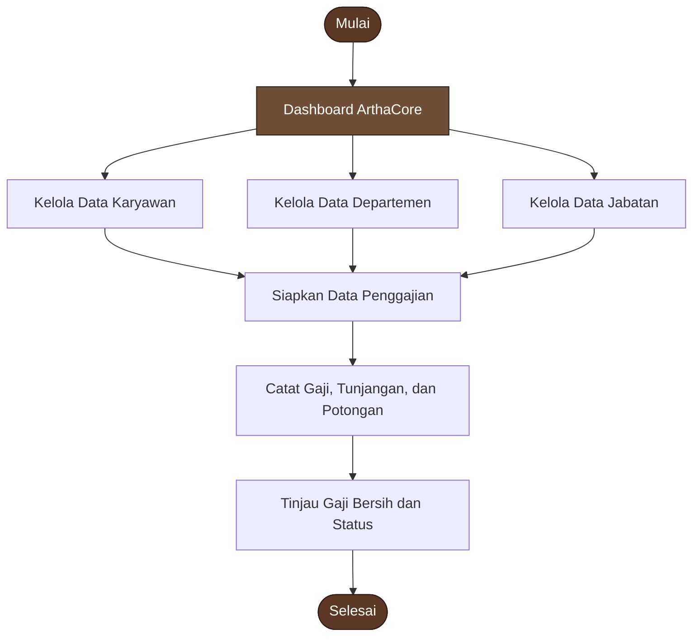

# ArthaCore
### Enterprise Payroll System

**Sistem pengelolaan data karyawan dan penggajian perusahaan berbasis web**

  

---

## Identitas Penyusun

| Keterangan | Identitas |
|:--|:--|
| **Nama** | Fania Hidayatul Mustafidah |
| **NIM** | 12030124130178 |
| **Mata Kuliah / Kelas** | Pengkodean dan Pemrograman / D |
| **Dosen Pengampu** | Dr. Totok Dewayanto, S.E., M.Si., Akt., CA |
| **Program Studi** | S1 Akuntansi |
| **Fakultas** | Ekonomika dan Bisnis |
| **Universitas** | Universitas Diponegoro |

---

## 01 — Gambaran Proyek

**ArthaCore** merupakan sistem penggajian karyawan berbasis web yang dirancang untuk membantu pengelolaan informasi sumber daya manusia dan administrasi payroll dalam satu ruang kerja. Sistem ini memiliki tampilan bergaya *enterprise* dengan fokus pada kemudahan navigasi, penyajian ringkasan, dan pengelolaan data yang terstruktur.

Melalui ArthaCore, pengguna dapat mengakses dashboard, mengelola data karyawan, menyusun struktur departemen dan jabatan, serta mencatat proses penggajian berdasarkan periode. Proyek ini dikembangkan sebagai bagian dari mata kuliah **Pengkodean dan Pemrograman** pada Program Studi S1 Akuntansi, Fakultas Ekonomika dan Bisnis, Universitas Diponegoro.

## 02 — Fitur Sistem

<table>
<tr>
<td width="50%" valign="top">

### Dashboard
Menampilkan ringkasan informasi perusahaan, antara lain:
- Total karyawan
- Jumlah departemen
- Posisi jabatan
- Payroll bulan berjalan
- Tren gaji bersih enam bulan terakhir
- Komposisi karyawan berdasarkan departemen
- Aktivitas penggajian terbaru

### Data Karyawan
Mendukung pengelolaan informasi karyawan, termasuk:
- Nama dan kode karyawan
- Informasi perusahaan
- Departemen dan jabatan
- Tanggal bergabung
- Status karyawan
- Gaji pokok

</td>
<td width="50%" valign="top">

### Data Departemen
Digunakan untuk mengelola unit dan struktur organisasi perusahaan, termasuk pencarian data departemen.

### Data Jabatan
Membantu pengelolaan posisi dalam perusahaan dengan informasi seperti:
- Nama jabatan
- Grade
- Gaji pokok
- Tunjangan
- Jumlah karyawan pada jabatan terkait

### Data Penggajian
Digunakan untuk mencatat dan meninjau informasi payroll, meliputi:
- Karyawan dan periode penggajian
- Gaji pokok
- Tunjangan
- Potongan
- Gaji bersih
- Status pembayaran

</td>
</tr>
</table>

### Akses cepat

Dashboard juga menyediakan akses langsung untuk menambahkan karyawan, mengatur departemen, dan membuat catatan penggajian agar aktivitas utama dapat dijangkau dengan lebih praktis.

---

## 03 — Alur Penggunaan

Alur di atas menggambarkan proses penggunaan secara umum: data karyawan dan struktur organisasi dikelola terlebih dahulu, kemudian digunakan sebagai dasar pencatatan penggajian.

---

## 04 — Identitas Visual

ArthaCore menggunakan pendekatan visual **cokelat tua** untuk membangun kesan profesional, stabil, dan elegan. Warna netral dan aksen cokelat membantu menjaga tampilan tetap konsisten untuk kebutuhan administrasi HR dan Finance.

| Warna | Kode warna | Peran visual |
|:--|:--|:--|
|  **Espresso** | `#2B1B14` | Warna gelap utama dan kontras |
|  **Dark Brown** | `#3B271C` | Elemen pendukung dan penekanan |
|  **Walnut** | `#5A3825` | Warna aksen utama |
|  **Warm Brown** | `#6F4E37` | Aksen sekunder dan label |
|  **Cream** | `#F5F0E8` | Warna netral pendamping |

*Kode warna di atas merupakan palet dokumentasi yang diselaraskan dengan tema cokelat tua, bukan hasil pengukuran langsung seluruh warna CSS website.*

---

## 05 — Teknologi dan Platform

| Komponen | Teknologi / platform | Kegunaan |
|:--|:--|:--|
| Antarmuka | Web (HTML, CSS, JavaScript sesuai implementasi proyek) | Menyajikan halaman dan interaksi sistem |
| Database | Supabase | Platform basis data yang disiapkan untuk proyek |
| Hosting | GitHub Pages | Menayangkan aplikasi melalui web |
| Dokumentasi | Markdown (`README.md`) | Menjelaskan sistem dan cara mengaksesnya |

> **Catatan:** rincian implementasi dan konfigurasi database dapat disesuaikan dengan versi kode yang digunakan pada repository.

---

## 06 — Struktur Menu

| Menu | Fungsi |
|:--|:--|
| **Dashboard** | Melihat ringkasan data dan aktivitas payroll |
| **Karyawan** | Mengelola data karyawan |
| **Departemen** | Mengelola unit organisasi |
| **Jabatan** | Mengelola posisi dan informasi kompensasi jabatan |
| **Penggajian** | Mencatat dan memantau data penggajian |
| **Pengaturan Perusahaan** | Mengatur workspace perusahaan dan konfigurasi proyek Supabase |

---

## 07 — Cara Mengakses

Aplikasi dapat dibuka langsung melalui tautan GitHub Pages berikut:

**[Buka ArthaCore — Enterprise Payroll System](https://faniahm7.github.io/SistemPenggajianKaryawan/)**

1. Buka tautan aplikasi menggunakan browser modern seperti Google Chrome, Microsoft Edge, atau Mozilla Firefox.
2. Tunggu sampai dashboard selesai dimuat.
3. Pilih menu yang dibutuhkan melalui navigasi sistem.
4. Gunakan menu data master untuk mengelola informasi karyawan, departemen, dan jabatan.
5. Buka menu penggajian untuk mencatat atau meninjau data payroll.

---

## 08 — Pengembangan Selanjutnya

Daftar berikut merupakan ide pengembangan yang dapat dipertimbangkan pada tahap berikutnya, bukan pernyataan bahwa fitur tersebut belum tersedia atau telah selesai dibuat.

- [ ] Penyempurnaan validasi input pada seluruh formulir.
- [ ] Penyediaan laporan penggajian berdasarkan periode.
- [ ] Fitur ekspor laporan ke format Excel atau PDF.
- [ ] Pengaturan hak akses berdasarkan peran pengguna.
- [ ] Riwayat perubahan data dan aktivitas pengguna.
- [ ] Penguatan pengujian keamanan dan integritas data.
- [ ] Penyempurnaan tampilan responsif untuk berbagai ukuran layar.

---

## 09 — Catatan Keamanan

Data penggajian dapat memuat informasi internal dan sensitif. Sebelum digunakan pada lingkungan operasional, pastikan konfigurasi database dan akses sudah ditinjau dengan baik, termasuk:

- Jangan menaruh **service role key** atau kredensial rahasia di kode frontend atau repository publik.
- Aktifkan dan uji kebijakan **Row Level Security (RLS)** sesuai kebutuhan akses.
- Batasi izin baca, tambah, ubah, dan hapus data berdasarkan peran pengguna.
- Hindari menggunakan data karyawan asli ketika melakukan demo atau pengujian publik.

---

## ArthaCore

*Structured people. Smarter payroll.*

**Disusun oleh Fania Hidayatul Mustafidah**  
S1 Akuntansi · Fakultas Ekonomika dan Bisnis  
Universitas Diponegoro

[**Kunjungi Sistem**](https://faniahm7.github.io/SistemPenggajianKaryawan/)

